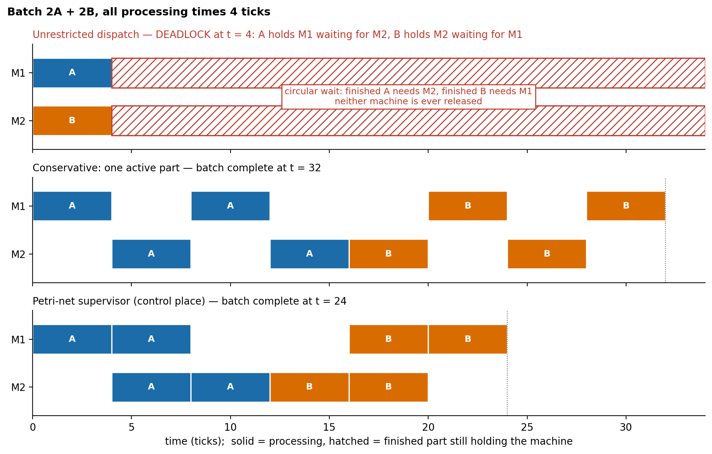
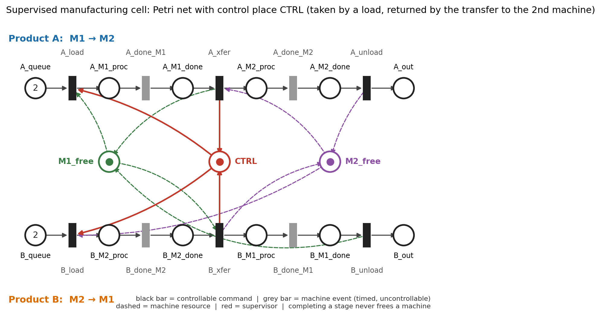

# Deadlock prevention for a blocking two-machine manufacturing cell

**A Petri-net model, proofs, closed-form results, and a cross-validated C++ execution engine — reproducible with one command.**

[](https://github.com/mohamedghoneim281/deadlock-prevention/actions/workflows/ci.yml)


> **Technical report:** *Deadlock Prevention in a Blocking Two-Machine Manufacturing Cell with a Single Petri-Net Control Place: Proofs, Closed-Form Results, and a Cross-Validated C++ Execution Engine* — arXiv:[XXXX.XXXXX](https://arxiv.org/abs/XXXX.XXXXX) *(link to be added)*

## What this is

In a blocking flow line, a finished part keeps its machine until the next machine accepts it. If two products visit the same two machines in opposite order, the cell can freeze: a part finished on **M1** waits for **M2**, while a part finished on **M2** waits for **M1**. This repository studies the *smallest* cell with that failure and asks one question:

> **How much production concurrency can be retained while preventing deadlock?**

Short answer, for this cell: **all the safe concurrency there is.** One control (monitor) place — a generalized mutual-exclusion constraint on first-stage occupancy — makes the cell deadlock-free and nonblocking, and *no* deadlock-free, nonblocking supervisor that observes the cell state (and cannot disable machine events) can allow more behaviour. It also never interferes with a run that would have succeeded anyway, finishes the batch **10–25 % faster** than the conservative "one part at a time" policy, and reaches the **exact optimum** makespan in every instance tested.

The monitor-place technique itself is established (Giua, DiCesare & Silva 1992; Yamalidou et al. 1996; Moody & Antsaklis 1998). This repository does **not** claim a new algorithm. What it adds is a complete, *proved* treatment of one cell, a timed evaluation, and an implementation whose agreement with an independent one is demonstrated rather than assumed.

<p align="center">
  
</p>
<p align="center"><sub>Batch of 2 A + 2 B, all operations 4 ticks. Top: unrestricted dispatch loads A on M1 and B on M2 at t=0 and freezes at t=4 (hatched = finished parts still holding their machines). Middle: one active part, makespan 32. Bottom: control place, makespan 24 — parts of one product pipeline through the machines.</sub></p>

## Quick start

**Ubuntu / Debian / Raspberry Pi OS — one command** (installs missing build tools, creates a private `.venv`, then builds, tests, verifies, experiments, benchmarks, plots, and prints a PASS/FAIL summary; about 20 s plus package installation):

```bash
git clone https://github.com/mohamedghoneim281/deadlock-prevention.git
cd deadlock-prevention
bash scripts/setup_ubuntu.sh
```

**Any other Unix-like system** (needs Python ≥ 3.10 and a C++17 compiler):

```bash
python3 -m venv .venv && . .venv/bin/activate
pip install -r requirements.txt        # numpy, matplotlib, pytest
make reproduce
```

Success looks like this at the end of the output:

```
 [PASS] Unrestricted cell: 97 reachable markings, 4 deadlocks
 [PASS] Control-place supervisor: 81 markings, 0 deadlocks, batch always completable
 [PASS] Supervisor equals the maximally permissive safe behaviour
 ...                                                        (15 checks in total)
 [PASS] Python vs C++: 0 mismatches in simulations, replays and rejected-command tests
 ALL CHECKS PASSED
```

Then open `results/RESULTS.md` (every number, auto-generated) and `figures/`.

### Try the engine (30 seconds)

The C++ engine loads the same net file that Python exports. Replay the shortest route to deadlock on the unrestricted cell:

```console
$ build/petri_engine replay results/net_unrestricted.txt examples/deadlock_trace.txt
0|INIT|2,2,1,1,0,0,0,0,0,0,0,0,0,0|A_load,B_load
1|FIRE A_load|1,2,0,1,1,0,0,0,0,0,0,0,0,0|B_load,A_done_M1
2|FIRE B_load|1,1,0,0,1,0,0,0,0,1,0,0,0,0|A_done_M1,B_done_M2
3|FIRE A_done_M1|1,1,0,0,0,1,0,0,0,1,0,0,0,0|B_done_M2
4|FIRE B_done_M2|1,1,0,0,0,1,0,0,0,0,1,0,0,0|-          # nothing enabled: deadlock
```

Each line is `step | event | marking (one number per place, in net-file order) | enabled transitions`. Now the same commands on the supervised cell — the control place refuses the second load:

```console
$ build/petri_engine replay results/net_supervisor.txt examples/deadlock_trace.txt
1|FIRE A_load|1,2,0,1,1,0,0,0,0,0,0,0,0,0,0|A_done_M1
ERROR|2|B_load|not enabled
```

Timed runs of the whole batch under each policy:

```console
$ for p in unrestricted one_active supervisor; do
>   build/petri_engine simulate results/net_$p.txt examples/scenario_batch.txt | tail -1; done
END 4 DEADLOCK
END 32 DONE
END 24 DONE
```

A guided console walk-through (failure → intervention → verification) for demonstrations:

```bash
. .venv/bin/activate && python scripts/demo.py --slow     # press Enter to step
```

## Results at a glance

Everything below is regenerated by `make reproduce`; full tables are in [`results/RESULTS.md`](results/RESULTS.md).

**Exhaustive verification, batch 2A + 2B**

| Policy | Reachable markings | Terminal deadlocks | Doomed markings¹ | Both machines processing |
|---|---:|---:|---:|---:|
| Unrestricted dispatch | 97 | 4 | 16 | 10 |
| One active part (conservative) | 57 | 0 | 0 | 0 |
| **Control-place supervisor** | **81** | **0** | **0** | **6** |
| *Maximally permissive reference* | *81* | | | |

¹ Markings from which the batch can no longer be completed. Only 4 of the 16 are terminal: **the point of no return comes before the machines visibly stop**, so detecting a stall is too late — prevention has to act on the commands. The supervisor equals the maximally permissive reference in *markings and transitions* (108 transitions); the conservative policy gives up 24 safe markings.

**Closed forms** (x = number of A parts, y = number of B parts; proved or machine-checked, see below):

| | Unrestricted | One active part | Supervisor |
|---|---|---|---|
| Reachable markings | 21xy + 5x + 5y − 7 | 9xy + 5x + 5y + 1 | 17xy + 5x + 5y − 7 |
| Terminal deadlocks | xy | 0 | 0 |
| Doomed markings | 4xy | 0 | 0 |
| Makespan, batch at t=0 | deadlock | x(α₁+α₂) + y(β₁+β₂) | P_A + P_B, with P_A = α₁ + (x−1)·max(α₁,α₂) + α₂ |

**Timed evaluation**

- *Deterministic grid* (81 time combinations × 2 priorities = 162 scenarios): unrestricted dispatch deadlocks in **162/162**; the supervisor is **17.8 % faster on average** than the conservative policy (range 10.0–25.0 %, always equal to the closed-form saving `(x−1)·min(α₁,α₂) + (y−1)·min(β₁,β₂)`), raises mean machine utilisation from 50 % to 61 %, and reaches the **exact optimum** (exhaustive timed search over all controllers, idling allowed) in **162/162**.
- *Monte Carlo* (16 000 staggered-arrival scenarios, common random numbers): **0 deadlocks in 32 000 controlled runs**; unrestricted dispatch deadlocks with probability 0.20–1.00. The supervisor's advantage shrinks as arrivals spread out (25 % → 0.4 %) — concurrency only matters under contention.
- *Transparency*: in the 4 140 scenarios where unrestricted dispatch happened to survive, the supervisor's makespan was **identical** in every one.

**C++ engine** (reference numbers: AMD Ryzen 7 6800H, Ubuntu 22.04, g++ 11.4.0 `-O2`; regenerated on your machine by `make reproduce` into `results/benchmark.json`)

| | 2A + 2B batch | 100A + 100B batch |
|---|---:|---:|
| Transition firings per run | 20 | 1 000 |
| Time per run | 0.49 µs | 9.3 µs |
| Time per firing | ≈ 24 ns | ≈ 9 ns |
| Step latency p50 / p99 | 50 / 61 ns | 60 / 71 ns |
| Python reference, same run | 38 µs (79× slower) | 1.4 ms (149× slower) |
| Peak resident memory | 3.4 MB (C++ runtime included) | 3.4 MB |
| Model data | 2.5 kB | 2.5 kB |

These measure interpretation of a *simulated* plant on a non-real-time OS; they include no I/O latency and are **not** worst-case execution times.

<p align="center">
  
</p>
<p align="center"><sub>The supervised cell. Black bars: controllable commands; grey bars: timed machine events (uncontrollable). Red control place <code>CTRL</code> is taken by the two loads and returned by the two <em>transfers</em>. Completing an operation never frees a machine.</sub></p>

## What is proved, and what is only checked

| Statement | Status | Checked by |
|---|---|---|
| Terminal deadlocks are exactly `x·y` markings; shortest route has 4 firings | Proved | `check_closed_forms.py` (36 batch shapes) |
| A `4xy`-marking absorbing region contains every deadlock and is doomed | Proved | same |
| Supervisor is deadlock-free and nonblocking; every complete run has exactly `5(x+y)` firings | Proved | `run_verification.py`, benchmark (20 and 1 000 firings) |
| Supervisor is **maximally permissive** (markings *and* transitions) for every batch size | Proved | `run_verification.py` (batches up to 4+4) |
| Supervisor is **transparent**: identical log whenever unrestricted dispatch completes | Proved | 4 140 + 743 scenarios |
| State-space sizes (table above) | Derived; reachability of each configuration class *confirmed by enumeration*, not proved | 36 batch shapes up to 6A+6B |
| Makespan closed forms | Proved for the stated dispatch rules | 800 simulations |
| Supervisor reaches the exact optimum | **Observation**, not proved | 162 grid scenarios + 42 larger instances |

The proofs are in the technical report (Section 5).

## How the two implementations are kept honest

Python exports the net to a plain-text file; the C++ engine loads **that file**, so both execute literally the same model with the same explicit rules (integer time, fixed dispatch priority, single-server timers). They are compared on four layers:

1. **Differential testing** — 900 randomised timed simulations; event logs must be identical byte for byte.
2. **Lock-step replay** — 1 201 event sequences (23 465 steps, including deadlocking runs): after every step both print marking *and* enabled set.
3. **Rejected commands** — 14 illegal firings must be refused identically.
4. **Non-vacuity** — feeding the engine a different net is detected; a deliberately *flawed* supervisor (permission returned at stage-1 completion instead of at the transfer) is found to deadlock by the checker; hand-computed cases (all times 1: unrestricted deadlocks at t=1, one-active finishes at t=8, supervisor at t=6).

Plus **193 automated tests**, and `make sanitize` pushes the whole campaign through an AddressSanitizer/UBSan build of the engine. The shared net file means this protocol cannot expose a *conceptual* error in the model; the closed forms and the progress invariant (`5N` firings per run) are the independent checks on that.

## Repository layout

```
petri/                 Python library (≈1 200 lines)
  net.py                 place/transition net, incidence matrices, export to the engine's text format
  cell.py                the cell and its three policies (unrestricted / one-active / supervisor)
  analysis.py            reachability, deadlock traces, nonblocking test, P-invariants (Farkas), maximally permissive reference
  verify.py              verification bundle and batch-size scaling
  timed.py               deterministic discrete-event simulator and metrics
  optimal.py             exact optimal makespan over all controllers
  experiments.py         deterministic grid and Monte Carlo (common random numbers)
  crosscheck.py, engine_io.py   Python <-> C++ comparison harness
cpp/                   C++17 engine (≈450 lines, header-only, no dependencies)
  petri_net.hpp, engine.hpp, main.cpp      modes: simulate | replay | bench
scripts/               one script per stage; run_all.py runs everything; check_results.py prints the PASS/FAIL box
tests/                 193 tests (hand-computed cases, closed forms, mutation test, cross-checks)
examples/              deadlock trace and batch scenario for the engine demo
results/               generated: RESULTS.md, CSV/JSON data, exported nets, matrices
figures/               generated: net diagram, Gantt, state space, experiment plots
.github/workflows/     CI: make reproduce + make sanitize on Python 3.10 and 3.12
```

`results/` and `figures/` are committed outputs of the evaluation run; `make reproduce` regenerates them.

| Command | Effect |
|---|---|
| `make` | build the C++ engine into `build/petri_engine` |
| `make test` | build and run the 193 tests |
| `make reproduce` | everything: build, tests, verification, closed-form checks, experiments, cross-validation, benchmark, figures, report, final check |
| `make sanitize` | rebuild the engine with ASan/UBSan and run the cross-validation campaign through it |
| `make clean` | remove build products and caches |

## Reproducibility

All randomness is seeded and time is integral, so every output except the benchmark is deterministic. The nine deterministic result files that were compared (experiment tables, verification and scaling data, experiment summary, cross-validation summary, exported net and matrices) have **identical SHA-256 digests** on two different environments:

| | CPU | OS | Python | Compiler |
|---|---|---|---|---|
| A | AMD Ryzen 7 6800H | Ubuntu 22.04 | 3.10.12 | g++ 11.4.0 |
| B | Intel Xeon 2.8 GHz | Ubuntu 24.04 | 3.12.3 | g++ 13.3.0 |

CI re-runs the full pipeline on every push.

## Design decisions worth knowing

1. **Explicit unload.** Completing an operation *never* releases a machine; only a transfer or unload command does. This keeps one rule uniform and yields the 97 / 57 / 81 marking counts.
2. **"Maximally permissive" is computed, not assumed.** The reference is a fixpoint over the unrestricted plant (closed under uncontrollable events, always able to complete); the supervisor is compared with it at the level of states *and* transitions.
3. **Parts of one product are interchangeable tokens**, which makes the state space grow only quadratically with the batch size.
4. **Tie-breaking is explicit.** Dispatch priority is the transition order in the net file (unloads, transfers, loads); both load orders are evaluated.
5. **Integer ticks** make runs exactly reproducible and logs comparable byte for byte.

## Limitations

- Two machines, two opposite routes, reliable machines, atomic transfers, no buffers, deterministic processing times. Machine failures, buffers, larger layouts and stochastic times are not covered; maximally permissive deadlock avoidance is NP-hard in general, so the closed forms are a property of this small cell.
- Everything is software with **simulated machine signals**. Nothing has run on a PLC, an embedded board, or a physical machine.
- The deadlock *rates* in the Monte Carlo study depend on the assumed arrival model and are illustrative; the existence of the deadlock and its prevention are structural.
- The analysis code has not been compared against an established Petri-net tool (e.g. [TINA](https://projects.laas.fr/tina/)); the engine is not formally verified.

## Citation

```bibtex
@misc{YOURKEY2026petricell,
  author = {Mohamed Ghoneim},
  title  = {Deadlock Prevention in a Blocking Two-Machine Manufacturing Cell with a Single Petri-Net Control Place: Proofs, Closed-Form Results, and a Cross-Validated C++ Execution Engine},
  year   = {2026},
  note   = {DOI: 10.5281/zenodo.23485309},
  url    = {https://github.com/mohamedghoneim281/deadlock-prevention}
}
```


## License

MIT — see [`LICENSE`](LICENSE).

## Contact

[Mohamed Ghoneim] · [g202522450@kfupm.edu.sa]
